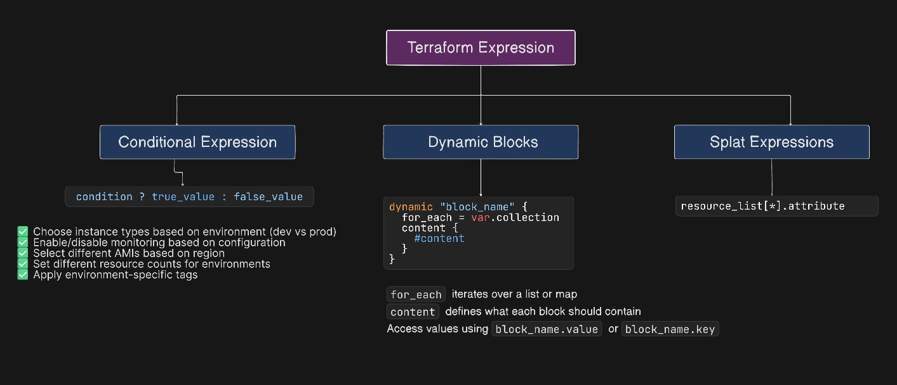

# Dynamic Blocks and Expressions

## Topics Covered
- [What is a Terraform Expression?](#what-is-a-terraform-expression)
- [Conditional Expressions](#conditional-expressions)
- [Dynamic Blocks](#dynamic-blocks)
- [Splat Expressions](#splat-expressions)
- [Hands-on Lab Example](#hands-on-lab-example)

---

## What is a Terraform Expression?

A Terraform expression computes or returns values dynamically instead of hardcoding them. It follows the DRY (Don't Repeat Yourself) principle to eliminate duplicate code blocks and make configurations dynamic, concise, and maintainable.



---

## Conditional Expressions

Conditional expressions perform if/else logic directly inside attribute assignments.

### Syntax
```terraform
condition ? true_value : false_value
```

### Example
```terraform
# Use t3.micro in prod, but t2.micro in dev
instance_type = var.Environment == "prod" ? "t3.micro" : "t2.micro"
```

### How it works:
- If the condition is true, it returns `true_value`.
- If the condition is false, it returns `false_value`.
- Works similarly to ternary operators in general programming languages.

### Use Cases:
- Choosing instance types based on the environment (dev vs. prod).
- Enabling/disabling monitoring based on configuration.
- Selecting different AMIs based on region.
- Setting different resource counts for environments.
- Applying environment-specific tags.

### Benefits:
- Single configuration template for multiple environments.
- Reduces code duplication.
- Makes environment-specific differences explicit.
- Simplifies configuration management.
- Easy to understand and maintain.

### When to use:
- Environment-specific configurations.
- Feature flags (enable/disable features).
- Conditional resource creation.
- Region-specific settings.
- Cost optimization (deploying smaller resources in dev).

### When NOT to use:
- Complex logic with many nested conditions (use local values instead).
- When separate environment configuration files (`.tfvars`) are clearer.
- When all environments should remain identical.

---

## Dynamic Blocks

Dynamic blocks allow you to avoid repeating nested blocks (like Security Group ingress rules or EC2 storage tags) by generating them dynamically from a list or map.

- **`for_each`**: Iterates over a list, set, or map of objects.
- **`content`**: Defines what attributes each nested block should contain.
- Accesses current iteration values using `block_name.value` or `block_name.key`.

### Use Cases:
- Security group ingress/egress rules.
- Multiple EBS volumes on EC2 instances.
- IAM policy statements.
- Load balancer listeners.
- Route table routes.
- Any repeating nested block structure.

### Benefits:
- Eliminates repetitive nested code blocks.
- Easy to add, modify, or remove nested rules.
- Configuration is parameterized entirely through variables.
- Cleaner, more maintainable code.
- Supports complex collection data structures.

### When to use:
- Multiple similar nested blocks.
- Variable number of configuration parameters.
- Inline policies and SG rules.
- Any repeating block pattern.

### When NOT to use:
- Single or few static blocks (the syntax overhead is not worth it).
- When it makes the resource code significantly harder for teammates to read.
- For top-level resources (use `count` or `for_each` on the resource level instead).

### Best Practices:
- Use meaningful iterator names instead of the default generic names.
- Keep dynamic blocks simple and flat.
- Document the expected data structure of the variable.
- Validate input variables using custom type constraints.
- Avoid nesting dynamic blocks too deeply.

---

## Splat Expressions

Splat expressions extract a specific attribute from a list of resources into a clean list without needing complex loops.

### Syntax
```terraform
resource_type.name[*].attribute
```

### Example
```terraform
# Get a list of all IP addresses from a cluster of EC2 instances
output "all_instance_ips" {
  value = aws_instance.web[*].public_ip
}
```

### How it works:
- Takes a list of resources or objects.
- Extracts the specified attribute from each element.
- Returns a new list containing just those values.

### Use Cases:
- Getting all instance IDs from multiple EC2 instances.
- Extracting all subnet IDs from a VPC.
- Collecting all security group IDs.
- Getting private IPs from a list of instances.
- Extracting ARNs for outputs.
- Gathering resource attributes for other resources.

---

## Hands-on Lab Example

All expressions demonstrated in this guide are implemented in the [`lab`](./lab/) directory:

- [`variables.tf`](./lab/variables.tf) — Configuration variables for EC2 instances and dynamic security group ingress rules.
- [`main.tf`](./lab/main.tf) — Demonstrates:
  1. **Conditional Expression** to select dev vs. prod instance types.
  2. **Dynamic Block** to loop over ingress rules list.
  3. **Splat Expression** to collect all created instance IDs into local values.

### Commands to Run:
```bash
# Navigate to the lab folder
cd "docs/Module - 1 Core Concepts/010 - Dynamic Blocks and expressions/lab"

# Initialize
terraform init

# Validate configuration
terraform validate

# Plan changes
terraform plan
```
