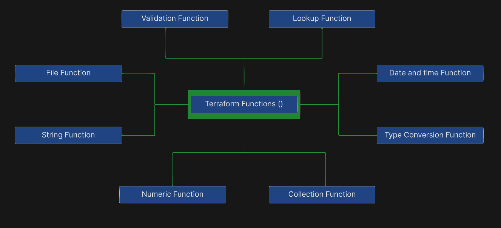

# Terraform Functions Part - 1

## Topics Covered
- [What is a Function?](#what-is-a-function)
- [What is a Terraform Function?](#what-is-a-terraform-function)
- [Types of Terraform Functions](#types-of-terraform-functions)
  - [String Functions](#string-functions)
  - [Collection Functions](#collection-functions)
  - [lookup Function](#lookup-function)
  - [Numeric Functions (Part 2)](../012%20-%20Functions%20in%20Terraform%20Part%202/012-function-in-terraform-part-2.md#numeric--math-functions)
  - [Filesystem Functions (Part 2)](../012%20-%20Functions%20in%20Terraform%20Part%202/012-function-in-terraform-part-2.md#filesystem-functions)
  - [Type Conversion Functions (Part 2)](../012%20-%20Functions%20in%20Terraform%20Part%202/012-function-in-terraform-part-2.md#type-conversion-functions)
  - [Date and Time Functions (Part 2)](../012%20-%20Functions%20in%20Terraform%20Part%202/012-function-in-terraform-part-2.md#date-and-time-functions)
  - [Validation Rules (Part 2)](../012%20-%20Functions%20in%20Terraform%20Part%202/012-function-in-terraform-part-2.md#variable-validation-rules)
- [Go to Functions Part 2](#go-to-functions-part-2)
- [Hands-on Lab Example](#hands-on-lab-example)

---

## What is a Function?

A function is a self-contained, reusable block of code designed to perform a specific task.

**Example**:
Finding the sum of two numbers — we pass two numbers to the function, and the function does the math and returns the sum.

---

## What is a Terraform Function?

In Terraform, we use HCL (HashiCorp Configuration Language). It is a configuration language, not a full general-purpose programming language.

Unlike general-purpose programming languages (like Python or Java) that support Object-Oriented Programming (OOP), custom classes, and arbitrary custom logic, HCL is designed specifically to declare infrastructure state. While it includes programming-like features (such as variables, conditionals, loops, and built-in functions), it is intentionally structured and restricted to focus on safety, readability, and state management.

In Terraform, there is no such thing as a "Custom Function". You can only use the built-in functions provided by Terraform Core; you cannot write your own custom functions.

To test built-in functions interactively, you can run:
```bash
terraform console
```

---

## Types of Terraform Functions



---

### String Functions

String functions are built-in tools used to format, combine, replace, split, and manipulate text strings.

#### Most Frequently Used String Functions

##### 1. Case Manipulation
* **`lower(string)`**: Converts all letters in a string to lowercase.
  ```terraform
  lower("PROD-SERVER")  # Output: "prod-server"
  ```
* **`upper(string)`**: Converts all letters in a string to uppercase.
  ```terraform
  upper("dev")          # Output: "DEV"
  ```
* **`title(string)`**: Capitalizes the first letter of each word.
  ```terraform
  title("web server")   # Output: "Web Server"
  ```

##### 2. Joining & Splitting Text
* **`join(separator, list)`**: Concatenates a list of strings into a single string using a delimiter.
  ```terraform
  join("-", ["app", "dev", "us-east-1"])  # Output: "app-dev-us-east-1"
  ```
* **`split(separator, string)`**: Splits a single string into a list of strings based on a delimiter.
  ```terraform
  split(",", "web,db,cache")            # Output: ["web", "db", "cache"]
  ```

##### 3. Replacing & Trimming
* **`replace(string, substring, replacement)`**: Replaces occurrences of a specific character or pattern.
  ```terraform
  replace("10.0.0.0/16", "/", "-")      # Output: "10.0.0.0-16"
  ```
* **`trimspace(string)`**: Removes leading and trailing whitespaces and newlines.
  ```terraform
  trimspace("  my-server-id  ")         # Output: "my-server-id"
  ```

##### 4. String Inspection & Formatting
* **`format(spec, values...)`**: Formats a string using C-style printf rules (great for padding numbers).
  ```terraform
  format("web-server-%02d", 3)          # Output: "web-server-03"
  ```
* **`substr(string, offset, length)`**: Extracts a substring starting at a specific index.
  ```terraform
  substr("ami-0c7217cdde317cfec", 0, 7) # Output: "ami-0c7"
  ```

#### Practical Lab Example:
From our [`lab/main.tf`](./lab/main.tf):
```terraform
locals {
  # Converts "Project XYZ Resource" to "project-xyz-resource"
  formatted_project_name = lower(replace(var.project_name, " ", "-"))

  # Truncates, converts to lowercase, and removes spaces/special characters
  # Converts "project alfa bucket with CAPS and spaces!!!" to "projectalfabucketwithcapsandspaces"
  formatted_bucket_name = replace(replace(
    substr(lower(var.bucket_name), 3, 63), " ", ""
  ), "!", "")

  # Cleans and splits "80, 443, 8080, 3306" into ["80", "443", "8080", "3306"]
  port_list = split(",", replace(var.allowed_ports, " ", ""))
}

resource "aws_s3_bucket" "name" {
  bucket = local.formatted_bucket_name
}
```

---

### Collection Functions

Collection functions are built-in tools used to inspect, manipulate, combine, transform, and extract data from collections—such as lists, maps, sets, and objects.

#### Most Frequently Used Collection Functions

##### 1. Element Operations
* **`element(list, index)`**: Retrieves a single element from a list at the given index. If the index is out of bounds, it wraps around.
  ```terraform
  element(["us-east-1a", "us-east-1b"], 0)  # Output: "us-east-1a"
  element(["us-east-1a", "us-east-1b"], 2)  # Output: "us-east-1a" (wraps around!)
  ```

##### 2. Size & Checking
* **`length(collection)`**: Returns the total number of elements in a list, map, set, or characters in a string.
  ```terraform
  length(["subnet1", "subnet2", "subnet3"]) # Output: 3
  ```
* **`contains(list, value)`**: Checks if a given value exists inside a list (returns true or false).
  ```terraform
  contains(["dev", "stage", "prod"], "dev") # Output: true
  ```

##### 3. Combining & Merging Collections
* **`merge(maps...)`**: Combines multiple maps into a single map. If keys overlap, the right-most map's value overrides the previous ones.
  ```terraform
  merge({ env = "dev" }, { owner = "ops" }) 
  # Output: { "env" = "dev", "owner" = "ops" }
  ```
* **`concat(lists...)`**: Joins two or more lists into a single combined list.
  ```terraform
  concat(["a", "b"], ["c", "d"]) 
  # Output: ["a", "b", "c", "d"]
  ```

##### 4. Cleaning & Flattening
* **`flatten(list)`**: Replaces nested lists with a single flat list.
  ```terraform
  flatten([["a", "b"], ["c", "d"]]) 
  # Output: ["a", "b", "c", "d"]
  ```
* **`compact(list)`**: Removes all empty strings ("") or null values from a list of strings.
  ```terraform
  compact(["web", "", "db", null]) 
  # Output: ["web", "db"]
  ```
* **`distinct(list)`**: Removes all duplicate values from a list.
  ```terraform
  distinct(["dev", "prod", "dev", "test"]) 
  # Output: ["dev", "prod", "test"]
  ```

#### Practical Lab Example:
From our [`lab/main.tf`](./lab/main.tf):
```terraform
locals {
  # Merges default tags and environment tags together
  new_tag = merge(var.default_tags, var.environment_tags)

  # Looks up environment instance size (defaults to "t2.micro" if not found)
  instance_size = lookup(var.instance_size, var.environment, "t2.micro")
}

resource "aws_s3_bucket" "name" {
  bucket = local.formatted_bucket_name
  tags   = local.new_tag
}
### lookup Function

The `lookup` function retrieves the value of a single key from a map. If the key does not exist in the map, it returns a specified default value instead of throwing an execution error.

#### Syntax
```terraform
lookup(map, key, default)
```

#### Examples
```terraform
lookup({ env = "dev" }, "env", "prod")    # Output: "dev"
lookup({ env = "dev" }, "owner", "admin") # Output: "admin" (default fallback)
```

#### Practical Lab Example
From our [`lab/main.tf`](./lab/main.tf):
```terraform
locals {
  # Looks up the environment size inside var.instance_size map
  # If var.environment (e.g. "dev") is found, it returns its size (e.g. "t2.micro")
  # If not found, it safely falls back to "t2.micro" without failing
  instance_size = lookup(var.instance_size, var.environment, "t2.micro")
}
```

---

## Go to Functions Part 2

For advanced functions and custom rules, please check out Part 2 of this guide:

* **[Terraform Functions Part - 2 (Numeric, Filesystem, Type Conversion, Date/Time, Validation)](../012%20-%20Functions%20in%20Terraform%20Part%202/012-function-in-terraform-part-2.md)**

---

## Hands-on Lab Example

All functions demonstrated in this guide are implemented in the [`lab`](./lab/) directory:

- [`variables.tf`](./lab/variables.tf) — Declarations for project names, allowed ports, and environment-based sizes.
- [`main.tf`](./lab/main.tf) — Main lab logic using string and collection functions.
- [`output.tf`](./lab/output.tf) — Outputs for formatting inspection.

### Commands to Run:
```bash
# Navigate to the lab folder
cd "docs/Module - 2 AWS resources using Terraform/011 - Functions in Terraform Part 1/lab"

# Initialize
terraform init

# Validate configuration
terraform validate

# Inspect values using the console
terraform console

# Preview outputs and plan
terraform plan
```
