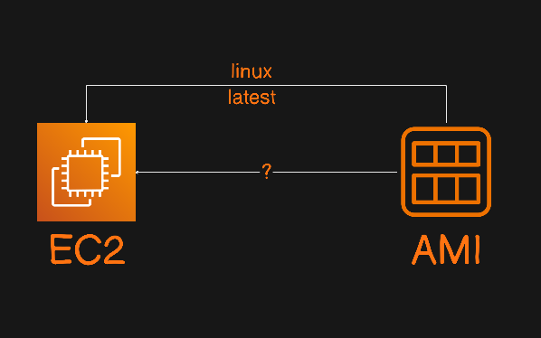
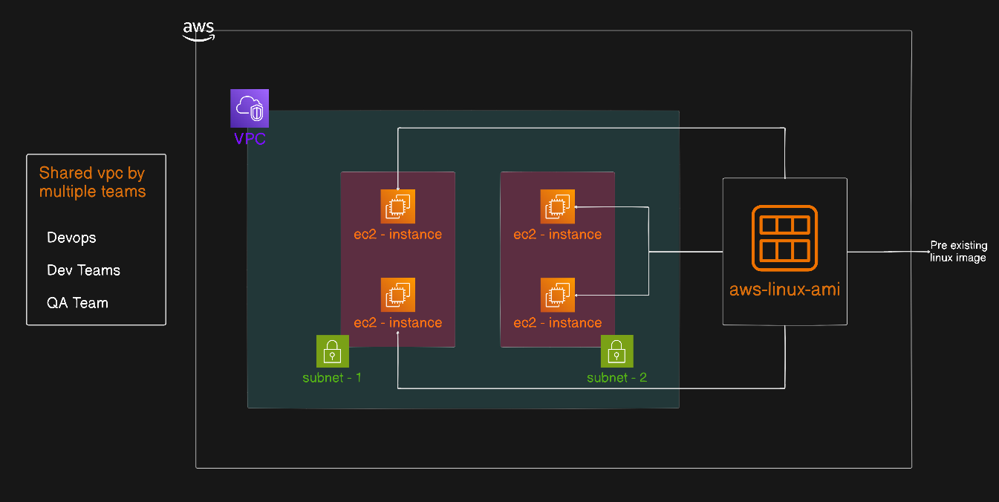

# Terraform Data Source

## Topics Covered
- [1. What is a Data Source?](#what-is-a-data-source)
- [2. Why We Use Data Sources](#why-we-use-data-sources)
- [3. Common Use Cases](#common-use-cases)
- [4. Infrastructure Design Overview](#infrastructure-design-overview)
  - [Real-Life Analogy: The Secure Tech Park](#real-life-analogy-the-secure-tech-park)
  - [Why We Use This Setup](#why-we-use-this-setup)
  - [Key Components](#key-components)
  - [With VPC vs. Without VPC](#with-vpc-vs-without-vpc)
  - [How It Works](#how-it-works)
- [5. Code Explanation](#code-explanation)
- [6. Hands-on Lab Example](#hands-on-lab-example)

---

## 1. What is a Data Source?



When provisioning a resource, it requires various configurations, including an AMI (Amazon Machine Image). Every operating system (e.g., Linux, Windows, etc.) has different versions of AMIs based on their releases.

An AMI is not stored inside your local environment; it works like an open-source repository where you retrieve the image and provision the resource.

When provisioning an instance, you need an AMI ID. But where do we get this ID? While you could go to the AMI release page in the AWS Console and manually copy the ID, you try to avoid manual steps as much as possible when working with automated Terraform workflows.

So what you do instead is use a feature available in Terraform called a **data source**. This AMI has a data source that allows you to dynamically fetch the required ID directly within your code.

### Definition
A Data Source in Terraform is a read-only request to fetch existing information from your cloud provider (like AWS) without creating or modifying any resources.

---

## 2. Why We Use Data Sources

Beginners often hardcode specific IDs like `ami-0c55b159cbfafe1f0` or `subnet-0123456789abcdef0` directly into their Terraform code. That approach breaks easily when switching AWS regions, migrating accounts, or updating AMI releases. Using data sources and filters makes your infrastructure dynamic, portable, and fully automated.

For a detailed, line-by-line explanation of our lab implementation, check out:
* **[Line-by-line Code Explanation](./explanation.md)**

---

## 3. Common Use Cases

- **Find Network Resources**: Look up existing VPCs or subnets built by other teams instead of recreating them.
- **Get Account & Region Info**: Automatically fetch your current AWS Account ID or region.
- **Retrieve Secrets Safely**: Pull database passwords or API keys from AWS Secrets Manager without putting them in code.
- **Reuse Security & Roles**: Attach existing IAM roles or security group rules to new resources.
- **Connect Terraform Files**: Read outputs created by a completely separate Terraform project or state file.

---

## 4. Infrastructure Design Overview



This design is a centralized AWS network architecture (shared VPC and subnets) combined with dynamic Terraform data sources to deploy EC2 instances without hardcoded values.

### Real-Life Analogy: The Secure Tech Park
Imagine you are building a Large Corporate Office Park:

* **VPC (Virtual Private Cloud)**: This is the fenced plot of land for your office park. It has a main entrance, security guards, and boundary walls. Nobody off the street can enter unless they go through security.
* **Subnet**: These are the individual buildings or floors inside your office park.
  - **Public Subnet**: The reception lobby and customer lounge. Anyone visiting the company can walk in, ask questions, or grab a coffee.
  - **Private Subnet**: The secure server room or executive accounting room in the basement. Only authorized personnel with special keycards can enter; regular visitors are blocked.
* **EC2 Instance**: These are the office desks or computers inside those floors where actual work gets done.
* **AMI (Amazon Machine Image)**: This is the standardized laptop blueprint given to every new employee. Instead of setting up Windows/Linux, installing apps, and configuring security manually for every single hire, IT hands everyone a pre-configured laptop template that is ready to go.
* **Data Source**: This is calling the HR/Facilities department to ask, "Which desk is open in Building B?" or "What is the latest company laptop build number?" instead of walking around guessing.

This architecture is a centralized, automated cloud setup built using Terraform. Instead of every team building their own small separate office buildings (VPCs), the company builds one big, secure office park (Shared VPC). Developers then use automated scripts (Terraform Data Sources) to instantly look up open floors (subnets) and standard laptop builds (AMIs) to launch their servers (EC2 instances).

### Why We Use This Setup
- **Reduces Costs**: Prevents teams from creating duplicate VPCs and gateways.
- **Improves Security**: Ensures network rules are managed centrally and instances use patched, up-to-date operating systems.
- **Eliminates Hardcoding**: Automatically fetches active AMI and subnet IDs at runtime using Terraform.
- **High Availability**: Spreads EC2 instances across multiple Availability Zones (subnets) to prevent single-point failures.

### Key Components
- **Shared VPC**: A single, central network used by multiple teams (DevOps, Dev, QA).
- **Subnets**: Isolated network partitions within the VPC placed across different Availability Zones. A Subnet (short for "sub-network") is a smaller, logically divided section of IP addresses within a VPC used to organize, route, and secure your resources.
- **AWS AMI Data Source**: A dynamic search query in Terraform that finds the latest official Linux OS image.
- **EC2 Instances**: Virtual servers deployed inside the designated subnets.

### With VPC vs. Without VPC
- **Without VPC**: Your EC2 instance is exposed directly to the entire internet. Anyone on the web could try to scan its ports, brute-force its passwords, or attack it directly.
- **With VPC**: Your EC2 instance lives inside a shielded virtual network. You control the entrance. Nothing can get in or out unless you explicitly open a port (using Security Groups and Subnets).

### How It Works
1. **Network Discovery**: Terraform queries AWS using data sources to fetch the existing VPC and Subnet IDs.
2. **Image Discovery**: Terraform queries AWS to locate the newest available Linux AMI ID.
3. **Resource Provisioning**: Terraform injects the fetched Subnet and AMI IDs to launch the EC2 instances directly into the shared network.

This architecture simplifies cloud management by allowing administrators to control network security centrally while developers automatically provision secure, up-to-date servers using clean Terraform code.

---

## 5. Code Explanation

We have prepared a comprehensive description mapping variables and resource creations line-by-line:
* **[View explanation.md](./explanation.md)**

---

## 6. Hands-on Lab Example

All files and resources are available in the [`lab`](./lab/) directory:

- [`variables.tf`](./lab/variables.tf) — Declarations for instance types.
- [`main.tf`](./lab/main.tf) — Queries AWS VPC, subnets, and AMIs dynamically and deploys EC2 instances.
- [`terraform.tfvars`](./lab/terraform.tfvars) — Environment configurations.

### Commands to Run:
```bash
# Navigate to the lab folder
cd "docs/Module - 2 AWS resources using Terraform/013 - Terraform Data Source/lab"

# Initialize
terraform init

# Validate configuration
terraform validate

# Preview execution plan
terraform plan
```
