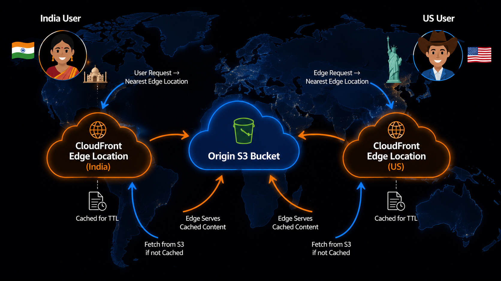
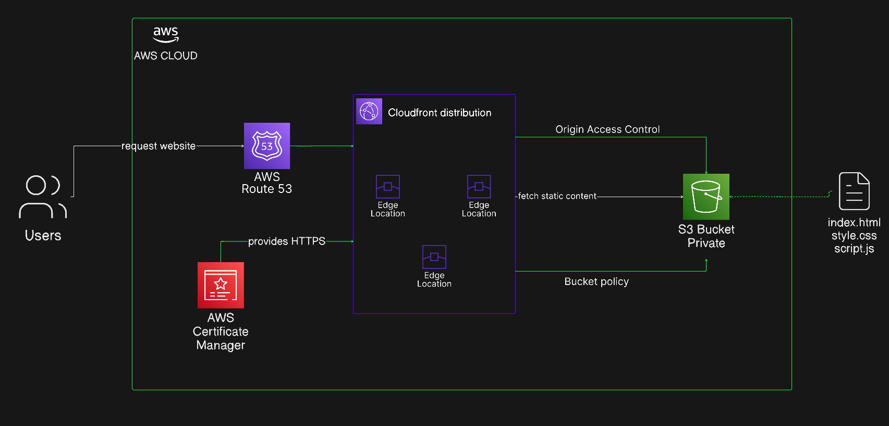

# Static Website Hosting (Mini Project 1)

## Topics Covered
- [1. How Static Website Hosting Works](#how-static-website-hosting-works)
- [2. System Architecture Details](#system-architecture-details)
- [3. Line-by-line Code Explanation](#line-by-line-code-explanation)
- [4. Hands-on Lab Example](#hands-on-lab-example)

---

## 1. How Static Website Hosting Works



### Architecture Overview
The system relies on an AWS S3 Bucket acting as the central Origin storing primary static files (index.html, CSS, JavaScript, assets). An AWS CloudFront Content Delivery Network (CDN) sits in front of the bucket, using globally distributed Edge Locations to serve incoming requests closer to users.

### Request Handling Lifecycle
1. **Initial User Request**: The user sends an HTTP/HTTPS request, which routes automatically to the nearest CloudFront Edge Location rather than connecting directly to the origin S3 bucket.
2. **Cache Miss (Fetch Phase)**: If the requested file is not stored in the local Edge cache, CloudFront pulls the file from the origin S3 bucket, delivers it to the user, and caches a local copy.
3. **Cache Hit (Serving Phase)**: For subsequent requests from users in that region, CloudFront serves the file directly from the local Edge cache without querying the S3 bucket until the Time to Live (TTL) expires.

### Primary Infrastructure Advantages
- **Reduced Latency**: Delivers content faster by reducing geographic distance between the client and content server.
- **Cost Efficiency**: Significantly reduces direct read requests to the origin S3 bucket.
- **Enhanced Security**: Enables restricting direct access to the S3 bucket, allowing public access strictly via secure CloudFront endpoints.

---

## 2. System Architecture Details



### Amazon S3 (Simple Storage Service)
An object storage service that holds static files like HTML, images, and videos in buckets. It serves as the primary storage origin for static websites and data backups.
- **Origin Access Control (Authentication)**: Verifies who is making the request to S3 by checking the AWS identity signature.
- **S3 Bucket Policy (Authorization)**: Defines what that verified identity is allowed to do (e.g., granting read access while blocking public access).

### Amazon Route 53
A scalable Domain Name System (DNS) service that translates human-readable domain names (like example.com) into numerical IP addresses or targets, routing internet traffic to your resources.

### AWS Certificate Manager (ACM)
A service used to issue, manage, and deploy SSL/TLS security certificates. It enables HTTPS encryption for custom domains linked to CloudFront distributions or load balancers.

### Amazon CloudFront
A Content Delivery Network (CDN) service that speeds up static and dynamic web content delivery by caching website files at globally distributed Edge Locations close to users.
- **Edge Locations**: Global data centers in AWS's edge network positioned close to end users to deliver content with low latency.

---

## 3. Line-by-line Code Explanation

We have prepared a comprehensive, resource-by-resource and line-by-line breakdown mapping S3 configs, secure CloudFront distributions, object MIME parsing, and automated SSL cert checks:
* **[View explanation.md](./explanation.md)**

---

## 4. Hands-on Lab Example

All files and static assets are located in the [`lab`](./lab/) directory:

* **Static Assets**: [`lab/www/index.html`](./lab/www/index.html), [`lab/www/style.css`](./lab/www/style.css), and [`lab/www/script.js`](./lab/www/script.js).
* **Terraform IaC**: Infrastructure scripts reside in the [`lab/terraform/`](./lab/terraform/) directory.

### Commands to Run:
```bash
# Navigate to the terraform configuration folder
cd "docs/Module - 2 AWS resources using Terraform/014 - Static Website Hosting (Mini Project 1)/lab/terraform"

# Initialize
terraform init

# Validate configuration
terraform validate

# Deploy infrastructure
terraform apply
```
