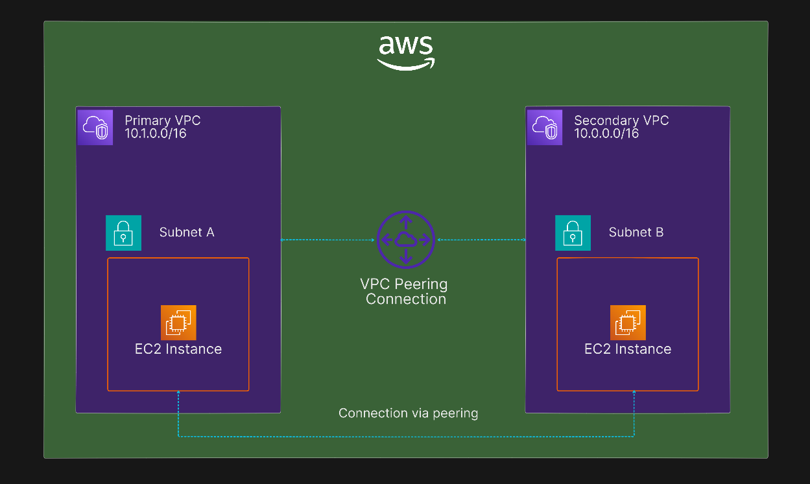
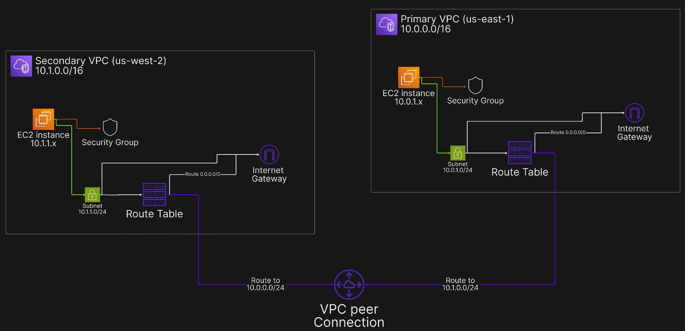
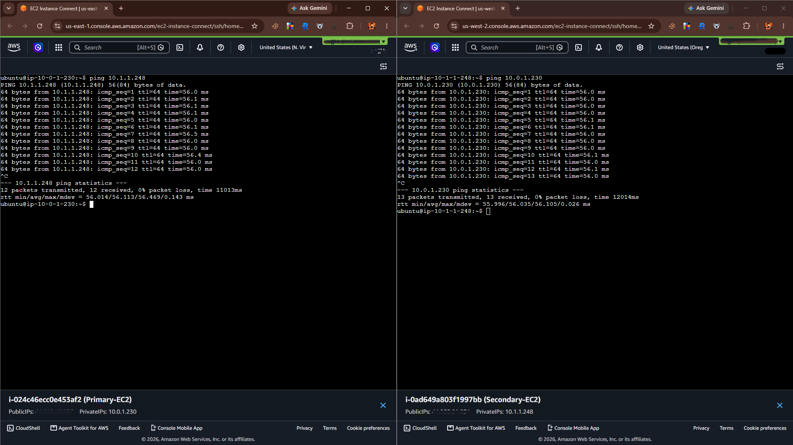

# VPC and Peering ( Mini Project 2 )

## Covered Topics
- [1. Core Concepts & Prerequisites](#1-core-concepts--prerequisites)
  - [VPC Peering Overview](#vpc-peering-overview)
  - [AWS VPC (Virtual Private Cloud)](#aws-vpc-virtual-private-cloud)
  - [CIDR Blocks & Subnets](#cidr-blocks--subnets)
- [2. Our Project Architecture (Cross-Region VPC Peering)](#2-our-project-architecture-cross-region-vpc-peering)
  - [Architecture Explanation](#architecture-explanation)
- [3. Line-by-line Code Explanation](#3-line-by-line-code-explanation)
- [4. Hands-on Lab Example](#4-hands-on-lab-example)
- [5. Verification & Testing](#5-verification--testing)

---

## 1. Core Concepts & Prerequisites

These concepts are the building blocks you need to understand before deploying the lab infrastructure.

### VPC Peering Overview


- **What it is:** A direct, private connection between two VPCs.
- **How it works:** Resources talk to each other safely using private IP addresses, staying on AWS’s internal network.
- **Rule 1 (1-to-1 connection):** It connects strictly 2 VPCs per connection.
- **Rule 2 (No chaining):** If VPC A connects to B, and B connects to C, A cannot talk to C unless you create a direct peer between A and C. Transitive peering will not work.

### AWS VPC (Virtual Private Cloud)
A Virtual Private Cloud (VPC) represents an isolated virtual network provisioned within an AWS region.
- **The VPC (Your Mini-Internet World):** An isolated space in AWS with its own private IP addresses that nobody outside can see by default.
- **The Internet Gateway (IGW):** The main entrance/border checkpoint that links your mini-internet world to the global public internet.
- **The Subnets (The Rooms):**
  - **Public Subnet:** A room right near the entrance that has a route pointing directly to the Internet Gateway. Anyone from the public internet can enter if the door (Security Group) allows it.
  - **Private Subnet:** A room hidden deep inside the house with no route to the Internet Gateway. It is completely locked off from direct outside visits.

### CIDR Blocks & Subnets
- **Subnet Mask:** The number after the slash (like `/16` or `/24`). It defines how big your IP address pool is. `/16` gives 65,536 IPs, while `/24` gives 256 IPs.
- **CIDR Block:** A combination of a Base IP + Subnet Mask (e.g., `10.0.0.0/16`). It defines the exact range of IP addresses.
- **Validation Rule:** A subnet's CIDR must fit entirely inside the VPC's CIDR. For example, a subnet of `10.0.1.0/24` is valid inside a VPC of `10.0.0.0/16`, but `10.1.0.0/24` will fail with an error because it falls outside the VPC range.

---

## 2. Our Project Architecture (Cross-Region VPC Peering)

This is the design of the project we are building in this lab:



### Architecture Explanation
Here is how our project architecture works in simple points:

1. **Two AWS Regions**: 
   - **Primary Region (`us-east-1`)**: Houses our main infrastructure resources.
   - **Secondary Region (`us-west-2`)**: Houses our peering target resources.

2. **Non-Overlapping VPCs**:
   - **Primary VPC** is assigned the `10.0.0.0/16` CIDR range.
   - **Secondary VPC** is assigned the `10.1.0.0/16` CIDR range. 
   - *Since the CIDR blocks do not overlap, routing traffic between them is possible.*

3. **Public Subnets**:
   - Each VPC has a public subnet (`10.0.1.0/24` and `10.1.1.0/24` respectively) configured to automatically assign public IP addresses to resources launched inside them.

4. **Internet Gateways (IGWs)**:
   - Both VPCs are attached to their own local Internet Gateways to allow public SSH access for management.

5. **Cross-Region VPC Peering Connection**:
   - A secure peering link is requested by the Primary VPC and accepted by the Secondary VPC. 
   - This routes traffic directly and securely between the regions using AWS's private global fiber network.

6. **Custom Route Tables**:
   - Both route tables have a default route (`0.0.0.0/0`) pointing to their local IGW for internet access.
   - Importantly, cross-VPC routes are added: any traffic for `10.1.0.0/16` in the primary VPC is routed through the peering connection, and vice-versa.

7. **Compute & Security Groups**:
   - An EC2 instance running Ubuntu & Apache is launched in each region.
   - Security Groups permit incoming SSH globally and allow internal ICMP (Ping) and TCP traffic directly from the peering VPC's CIDR block.

---

## 3. Line-by-line Code Explanation

We have prepared a comprehensive, resource-by-resource and line-by-line breakdown mapping S3 backend setups, cross-region provider aliasing, dynamic AMI lookups, security groups, route entries, and peer connection accepters:
* **[View explanation.md](./explanation.md)**

---

## 4. Hands-on Lab Example

All configuration files are located in the [`lab`](./lab/) directory:

* **Terraform Configuration**: Infrastructure files reside in [`lab/`](./lab/).
* **Local Variables & Scripts**: Installs Apache dynamically using user data in [`lab/local.tf`](./lab/local.tf).

### Commands to Run:
```bash
# Navigate to the lab folder
cd "docs/Module - 2 AWS resources using Terraform/015 - VPC and Peering (Mini Project 2)/lab"

# Initialize Terraform with S3 backend
terraform init

# Validate configuration syntax
terraform validate

# Deploy cross-region VPCs and Peering
terraform apply
```

---

## 5. Verification & Testing

Once deployment completes, access the AWS EC2 Console in both regions to confirm the instance states. SSH into the primary EC2 instance, then ping the private IP address of the secondary EC2 instance to verify cross-region, private network connectivity.

Below is the verification screen proving successful cross-region private IP ping test:

