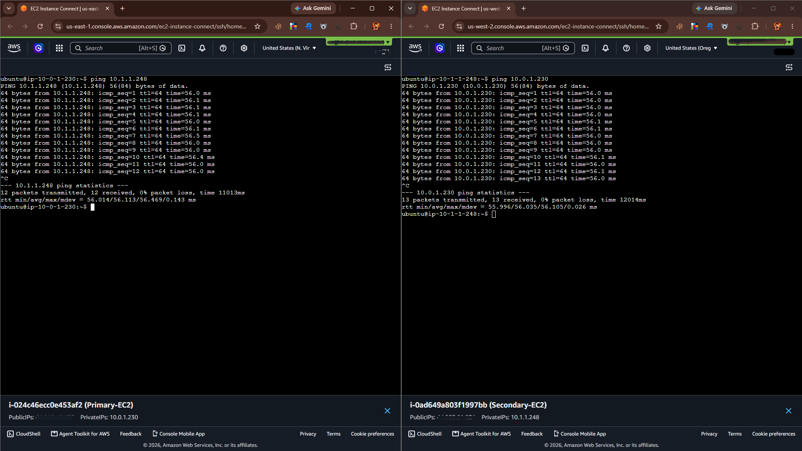

# Terraform VPC and Peering - Code Explanation

This document provides a detailed resource-by-resource and line-by-line explanation of the Infrastructure as Code (IaC) configuration inside the [`lab/`](./lab/) directory for the VPC Peering Mini Project.

---

## 1. Provider Configuration (`provider.tf`)

```terraform
terraform {
  required_providers {
    aws = {
      source  = "hashicorp/aws"
      version = "~>6.0"
    }
  }
}

provider "aws" {
  alias  = "primary"
  region = var.primary
}

provider "aws" {
  alias  = "secondary"
  region = var.secondary
}
```

* **`required_providers`**: Specifies that the AWS provider from HashiCorp is required with version version `~>6.0` (allowing updates within version 6.x).
* **Provider Aliases (`aws.primary` and `aws.secondary`)**: Because VPC Peering in this lab connects resources in two different AWS regions (e.g., `us-east-1` and `us-west-2`), we define two provider blocks:
  - `primary`: Uses the region specified in `var.primary`.
  - `secondary`: Uses the region specified in `var.secondary`.
  - All subsequent resources specify which provider alias to use via the `provider` attribute.

---

## 2. Backend Configuration (`backend.tf`)

```terraform
terraform {
  backend "s3" {
    bucket       = "terraform-backend-bucket-mini-project-2"
    key          = "dev/terraform.tfstate"
    region       = "us-east-1"
    encrypt      = true
    use_lockfile = true
  }
}
```

* **`backend "s3"`**: Configures Terraform to store the state file (`terraform.tfstate`) remotely in an Amazon S3 bucket named `terraform-backend-bucket-mini-project-2`.
* **`encrypt = true`**: Encrypts the state file at rest.
* **`use_lockfile = true`**: Enables locking using S3 lockfiles (supported in AWS provider v6+) to prevent concurrent state modifications.

---

## 3. Input Variables (`variables.tf` & `terraform.tfvars`)

### `variables.tf`
* **`environment`**: Categorizes the deployment (default: `"dev"`, set to `"production"` in tfvars).
* **`primary` / `secondary`**: Regions for our infrastructure (defaults: `us-east-1` / `us-west-2`).
* **`primary_vpc_cidr` / `secondary_vpc_cidr`**: CIDR blocks for the two VPCs:
  - Primary VPC: `10.0.0.0/16` (65,536 IP addresses).
  - Secondary VPC: `10.1.0.0/16` (65,536 IP addresses).
  - *Note: CIDR blocks must not overlap for VPC Peering to work.*
* **`primary_subnet_cidr` / `secondary_subnet_cidr`**: Subnet CIDR allocations:
  - Primary Subnet: `10.0.1.0/24` (256 IP addresses).
  - Secondary Subnet: `10.1.1.0/24` (256 IP addresses).
* **`primary_ingress_rules` / `secondary_ingress_rules`**: Lists of objects defining inbound security group rules:
  - Port 22 (SSH) open to all (`0.0.0.0/0`).
  - ICMP (Ping) protocol allowed from the peering VPC's CIDR block.
  - All TCP traffic (Ports 0-65535) allowed from the peering VPC's CIDR block.
* **`egress_rule`**: Outbound rules permitting all outbound traffic (`-1` protocol, destination `0.0.0.0/0`).

### `terraform.tfvars`
```terraform
environment = "production"

primary_key_name   = "vpc-peering-demo"
secondary_key_name = "vpc-peering-demo"
```
* Sets the target environment metadata to `production` and specifies the EC2 SSH Key Pair names to deploy.

---

## 4. Local Variables (`local.tf`)

```terraform
locals {
  # User data template for Primary instance
  primary_user_data = <<-EOF
    #!/bin/bash
    apt-get update -y
    apt-get install -y apache2
    systemctl start apache2
    systemctl enable apache2
    echo "<h1>Primary VPC Instance - ${var.primary}</h1>" > /var/www/html/index.html
    echo "<p>Private IP: $(hostname -I)</p>" >> /var/www/html/index.html
  EOF

  # User data template for Secondary instance
  secondary_user_data = <<-EOF
    #!/bin/bash
    apt-get update -y
    apt-get install -y apache2
    systemctl start apache2
    systemctl enable apache2
    echo "<h1>Secondary VPC Instance - ${var.secondary}</h1>" > /var/www/html/index.html
    echo "<p>Private IP: $(hostname -I)</p>" >> /var/www/html/index.html
  EOF
}
```

* **Bash Startup Scripts**: Automates the installation of an Apache web server on the EC2 instances. Once launched, they host a simple web page showing the instance's region and its private IP address.

---

## 5. Dynamic Data Sources (`data.tf`)

```terraform
data "aws_availability_zones" "primary" {
  state    = "available"
  provider = aws.primary
}

data "aws_availability_zones" "secondary" {
  state    = "available"
  provider = aws.secondary
}
```
* Queries AWS dynamically for active availability zones in the respective regions to avoid hardcoded zone names.

```terraform
data "aws_ami" "primary_ami" {
  provider    = aws.primary
  most_recent = true
  owners      = ["099720109477"] # Canonical's official AWS account ID
  filter {
    name   = "name"
    values = ["ubuntu/images/hvm-ssd/ubuntu-jammy-22.04-amd64-server-*"]
  }
  # ... (virtualization and architecture filters)
}
```
* Fetches the latest official Ubuntu 22.04 LTS AMI in both the primary and secondary regions dynamically.

---

## 6. Core Infrastructure (`main.tf`)

### VPCs and Subnets
```terraform
resource "aws_vpc" "primary_vpc" {
  provider   = aws.primary
  cidr_block = var.primary_vpc_cidr
  enable_dns_support   = true
  enable_dns_hostnames = true
  tags = { Name = "Primary-VPC-${var.primary}" }
}
```
* Provisions the VPC in the primary region using the CIDR block `10.0.0.0/16`. The secondary VPC is created similarly using `aws.secondary` provider and CIDR `10.1.0.0/16`.

```terraform
resource "aws_subnet" "primary_subnet" {
  provider                = aws.primary
  vpc_id                  = aws_vpc.primary_vpc.id
  cidr_block              = var.primary_subnet_cidr
  availability_zone       = data.aws_availability_zones.primary.names[0]
  map_public_ip_on_launch = true
  # ...
}
```
* Provisions a public subnet inside each VPC. Setting `map_public_ip_on_launch = true` ensures that EC2 instances launched here receive a public IPv4 address for management access.

### Internet Gateways and Route Tables
```terraform
resource "aws_internet_gateway" "primary-gw" {
  provider = aws.primary
  vpc_id   = aws_vpc.primary_vpc.id
}

resource "aws_route_table" "primary_route_table" {
  provider = aws.primary
  vpc_id   = aws_vpc.primary_vpc.id
  route {
    cidr_block = "0.0.0.0/0"
    gateway_id = aws_internet_gateway.primary-gw.id
  }
}
```
* Creates an Internet Gateway for external network connectivity and a custom Route Table routing all out-of-VPC traffic (`0.0.0.0/0`) out to the internet gateway.

### VPC Peering Connection & Accepter
```terraform
resource "aws_vpc_peering_connection" "primary_to_secondary" {
  provider    = aws.primary
  peer_region = var.secondary
  vpc_id      = aws_vpc.primary_vpc.id
  peer_vpc_id = aws_vpc.secondary_vpc.id
  auto_accept = false
}
```
* Initiates the VPC Peering Request from the Primary VPC (Requester) to the Secondary VPC (Accepter) across regions. Since cross-region peering cannot be auto-accepted in a single request, `auto_accept` is set to `false`.

```terraform
resource "aws_vpc_peering_connection_accepter" "secondary_accepter" {
  provider                  = aws.secondary
  vpc_peering_connection_id = aws_vpc_peering_connection.primary_to_secondary.id
  auto_accept               = true
}
```
* Accepts the peering request in the secondary region under the `aws.secondary` provider.

### Cross-VPC Peering Routing
```terraform
resource "aws_route" "primary_r" {
  provider                  = aws.primary
  route_table_id            = aws_route_table.primary_route_table.id
  destination_cidr_block    = var.secondary_vpc_cidr
  vpc_peering_connection_id = aws_vpc_peering_connection.primary_to_secondary.id
}
```
* Adds a route in the Primary VPC Route Table stating: "For any traffic destined for the Secondary VPC CIDR (`10.1.0.0/16`), send it over the VPC Peering Connection."
* A mirroring route `secondary_r` is defined in the Secondary VPC Route Table targeting the Primary VPC CIDR (`10.0.0.0/16`).

### Security Groups
```terraform
resource "aws_security_group" "primary_sg" {
  provider    = aws.primary
  vpc_id      = aws_vpc.primary_vpc.id

  dynamic "ingress" {
    for_each = var.primary_ingress_rules
    content {
      description = ingress.value.description
      from_port   = ingress.value.from_port
      to_port     = ingress.value.to_port
      protocol    = ingress.value.protocol
      cidr_blocks = ingress.value.cidr_blocks
    }
  }
  # ...
}
```
* Uses dynamic blocks to construct ingress rule sets based on variables, enabling SSH access globally and ICMP/TCP access specifically from the peering VPC CIDR range.

### EC2 Compute Instances
```terraform
resource "aws_instance" "primary_instance" {
  provider               = aws.primary
  ami                    = data.aws_ami.primary_ami.id
  instance_type          = var.instance_type
  subnet_id              = aws_subnet.primary_subnet.id
  vpc_security_group_ids = [aws_security_group.primary_sg.id]
  key_name               = var.primary_key_name
  user_data              = local.primary_user_data
  # ...
}
```
* Launches the Ubuntu EC2 instances within their respective subnets, configured with the correct security groups, SSH keys, and Apache installation user scripts.

---

## 7. Outputs (`output.tf`)

Prints the Public IP (for SSH management) and Private IP (for testing private connectivity) of both EC2 instances on completion of `terraform apply`.

---

## Verification and Testing

After deploying the infrastructure using `terraform apply`, you can verify that VPC Peering is working by connecting to one instance and pinging the other using its **private IP**:

1. SSH into the **Primary EC2 Instance** (e.g. `us-east-1`):
   ```bash
   ssh -i vpc-peering-demo.pem ubuntu@<PRIMARY_PUBLIC_IP>
   ```
2. Ping the **Secondary EC2 Instance** using its private IP:
   ```bash
   ping <SECONDARY_PRIVATE_IP>
   ```
   *Because the security group rules permit ICMP traffic across the VPC peer, and the route tables are correctly mapped, you will see responses.*

3. SSH into the **Secondary EC2 Instance** (e.g. `us-west-2`):
   ```bash
   ssh -i vpc-peering-demo-west.pem ubuntu@<SECONDARY_PUBLIC_IP>
   ```
4. Ping the **Primary EC2 Instance** using its private IP:
   ```bash
   ping <PRIMARY_PRIVATE_IP>
   ```

Below is the verification console output confirming that pinging the private IP address across the VPC Peering connection is successful:

