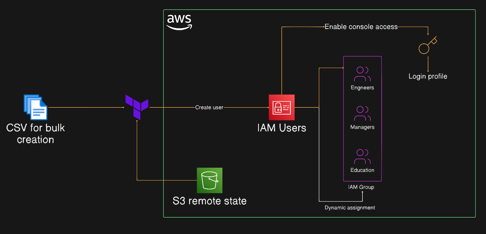

# AWS IAM User Management with Terraform ( Mini Project 3 )

## Topics Covered
- [1. Core Concepts & Prerequisites](#1-core-concepts--prerequisites)
  - [AWS IAM (Identity and Access Management)](#aws-iam-identity-and-access-management)
  - [IAM Users & Login Profiles](#iam-users--login-profiles)
  - [IAM Groups](#iam-groups)
  - [IAM Policies & MFA (Multi-Factor Authentication)](#iam-policies--mfa-multi-factor-authentication)
  - [Terraform `csvdecode()` Function](#terraform-csvdecode-function)
- [2. Our Project Architecture (AWS IAM User Management)](#2-our-project-architecture-aws-iam-user-management)
  - [Architecture Explanation](#architecture-explanation)
- [3. Line-by-line Code Explanation](#3-line-by-line-code-explanation)
- [4. Hands-on Lab Example](#4-hands-on-lab-example)
- [5. Verification & Testing](#5-verification--testing)

---

## 1. Core Concepts & Prerequisites

These service definitions are the building blocks you need to understand before deploying the lab infrastructure.

### AWS IAM (Identity and Access Management)
AWS Identity and Access Management (IAM) is a web service that helps you securely control access to AWS resources. You use IAM to control who is authenticated (signed in) and authorized (has permissions) to use resources.

### IAM Users & Login Profiles
- **IAM User**: An entity that you create in AWS to represent the person or service that uses it to interact with AWS. Each user has a unique username and associated metadata tags.
- **Login Profile**: An entity attached to an IAM user that allows them to log in to the AWS Management Console with a username and password.

### IAM Groups
An IAM Group is a collection of IAM users. Groups let you specify permissions for multiple users, which can make it easier to manage the permissions for those users (e.g. assigning roles like Accounting, Sales, and IT).

### IAM Policies & MFA (Multi-Factor Authentication)
- **IAM Policy**: A JSON document that defines permissions. Policies can be attached to users, groups, or roles to permit or deny specific actions on AWS resources.
- **MFA (Multi-Factor Authentication)**: A security practice that requires users to provide a second form of verification (such as a code from a virtual authenticator app) in addition to their password to access AWS services.

### Terraform `csvdecode()` Function
The `csvdecode()` function is a built-in Terraform function that decodes a string containing CSV data into a list of maps. Each map represents a row in the CSV file, mapping header names to row values. This enables dynamic resource provisioning from external spreadsheets.

> [!NOTE]
> **Prerequisite IAM Permissions for Deployment**:
> To run this project, your Terraform execution credentials must have permissions to manage IAM resources (e.g., `iam:CreateUser`, `iam:CreateGroup`, `iam:CreatePolicy`, `iam:AttachGroupPolicy`, and `iam:UpdateAccountPasswordPolicy`).

---

## 2. Our Project Architecture (AWS IAM User Management)

This is the design of the project we are building in this lab:



### Architecture Explanation
Here is how our project architecture works, explaining the visual flow and components in the diagram:

1. **User Roster Input**:
   - The architecture starts with an external list containing user profile fields (First Name, Last Name, Department, and Job Title). This data acts as the registry for provisioning.

2. **Global Password Policy**:
   - At the AWS Account level, a global password security layer is established. This configures account-wide rules for password complexity, forcing strong passwords (12+ characters, uppercase, lowercase, numbers, and symbols) for any console access.

3. **IAM User Creation**:
   - The system creates individual IAM Users in AWS. Each user gets a normalized username and metadata tags detailing their display name, department, and job title.

4. **Console Access Login Profiles**:
   - Every created IAM User is configured with console access capabilities. A secure login profile is attached, forcing a password reset when the user logs in for the first time.

5. **IAM Groups**:
   - Three core groups are established in AWS: `Education`, `Engineers`, and `Managers`. These act as administrative boundaries.

6. **Group Membership Connections**:
   - The users are automatically associated with the appropriate groups based on their tag values. For example, users tagged under the education department are joined to the `Education` group, while administrative and engineering roles are sorted into their respective groups.

7. **MFA Enforcer Policy**:
   - A custom security policy (MFA Policy) is created. This policy is attached to all three groups. It functions as a security gate: it denies all access to AWS services unless the user is actively authenticated using a multi-factor authentication (MFA) token, while permitting them to register their own MFA device and change their password.

---

## 3. Line-by-line Code Explanation

We have prepared a comprehensive, resource-by-resource and line-by-line breakdown explaining user loop constructs, dynamic group memberships, MFA JSON policies, and password outputs:
* **[View explanation.md](./explanation.md)**

---

## 4. Hands-on Lab Example

All files are located in the [`lab`](./lab/) directory:

- **Users Roster**: [`lab/users.csv`](./lab/users.csv).
- **Terraform IaC**: [`lab/main.tf`](./lab/main.tf), [`lab/groups.tf`](./lab/groups.tf), [`lab/local.tf`](./lab/local.tf).

### Commands to Run:
```bash
# Navigate to the lab folder
cd "docs/Module - 2 AWS resources using Terraform/016 - AWS IAM User Management (Mini Project 3)/lab"

# Initialize Terraform with S3 backend
terraform init

# Validate configuration
terraform validate

# Deploy IAM Users, Groups, and MFA Policies
terraform apply
```

---

## 5. Verification & Testing

Once deployment completes:
1. Retrieve the list of generated initial passwords:
   ```bash
   terraform output -json user_password
   ```
2. Log in using the custom console sign-in URL:
   `https://<YOUR_AWS_ACCOUNT_ID>.signin.aws.amazon.com/console`
3. Try to access any AWS resource (like S3 or EC2). Access will be denied until you configure MFA and log in again using your MFA token.
